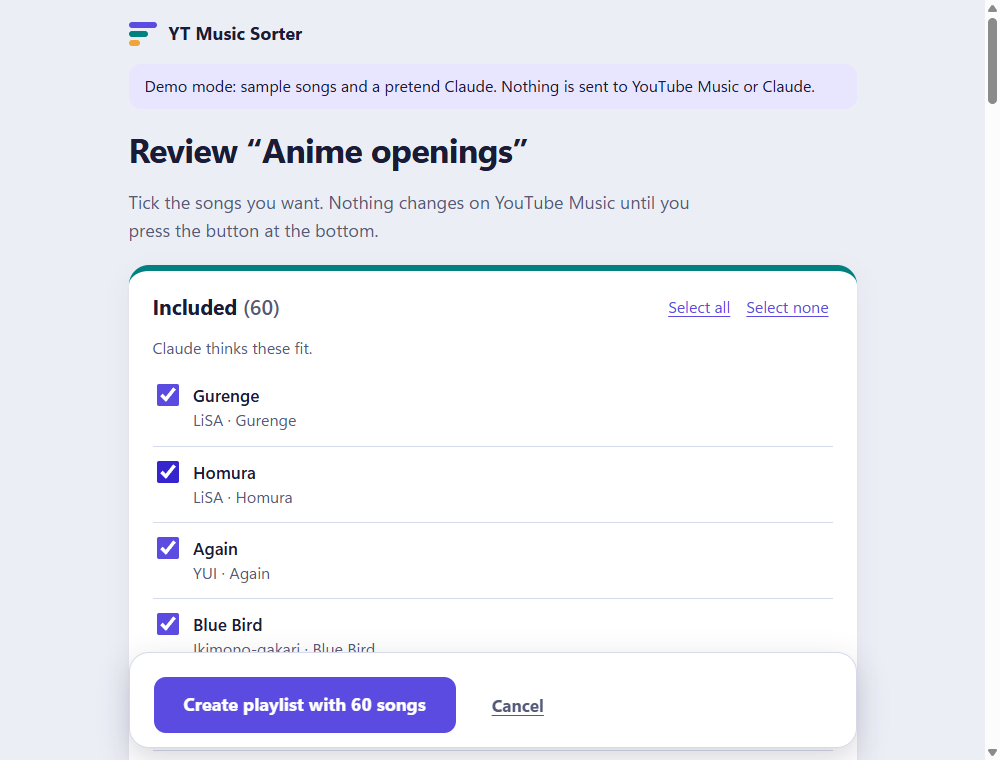
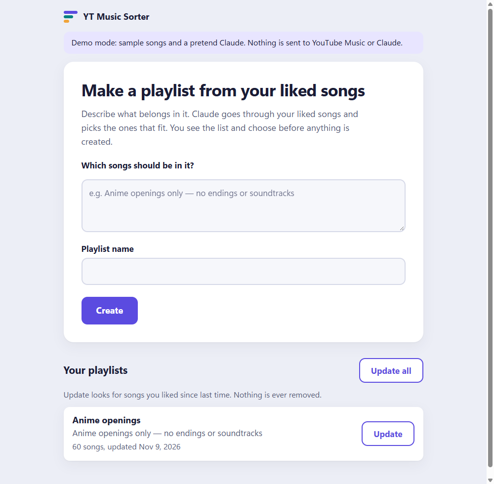

# YT Music Sorter

Turn your YouTube Music liked songs into playlists, just by describing them.

Type something like *"Anime openings only, no endings or soundtracks"* or *"Songs sung in Ukrainian"*. Claude goes through your liked songs and picks the ones that fit. You get a list with a checkbox next to every song, tick or untick what you like, and only then is the playlist created on your YouTube Music account. Later, one button adds the songs you liked since then.

The app runs on your own computer and opens in your web browser. Nothing is sent anywhere except to YouTube Music (your account) and to Claude (song titles and artists, to decide which songs fit).



*The screenshots in this guide come from the built-in demo, which uses sample songs.*

## What you need

- **Claude Code**, installed and logged in. You log in with your own Claude account, so there is no key to copy. The app will walk you through this if it is not set up yet.
- **A YouTube Music account** with some liked songs.
- A computer with an internet connection (Windows, macOS or Linux).

You do not need to install Python or anything else yourself. The start script does it.

## Download

1. On this page, click the green **Code** button, then **Download ZIP**.
2. Unzip it (on Windows: right-click the file, then **Extract All**).

If you use git, you can run `git clone` on this repository instead.

## Start

- **Windows:** double-click **`start.bat`** in the unzipped folder.
- **macOS / Linux:** open a terminal in the folder and run `./start.sh`.

A window with some text opens, and after a moment the app appears in your web browser. **Keep that window open while you use the app. Close it to stop the app.**

The first start takes a minute or two: it downloads a small helper called [uv](https://docs.astral.sh/uv/), which then sets up everything else. After that, starting is quick.

## First-time setup

The first time you open the app, it shows a short setup screen with two checks. Each one turns green when it is done. This is the same guide you see in the app, with the same steps.

### 1. Claude

1. Install Claude Code from the [official install page](https://docs.claude.com/en/docs/claude-code/setup).
2. Open a terminal. On Windows, press Start, type **Terminal** and open it. On a Mac, open **Terminal** from Applications, then Utilities.
3. Type `claude`, press Enter, and follow the steps to log in. You can close the terminal afterwards.
4. Go back to the app and press **Check again**.

### 2. YouTube Music

The app connects to your YouTube Music account by using a few details your browser sends when you use the site. You copy them once and paste them into the app. It takes about two minutes. The app shows these steps with a tab for your browser.

**Chrome or Edge**

1. Open [music.youtube.com](https://music.youtube.com) and make sure you are signed in.
2. Press `F12` to open the developer tools. On a Mac, press `Cmd`+`Option`+`I`.
3. Click the **Network** tab at the top of the developer tools.
4. Type `browse` into the filter box. If the list stays empty, click **Home** or **Library** on the YouTube Music page.
5. Right-click the first request in the list, then choose **Copy**, then **Copy request headers**.
6. Paste them into the box in the app (`Ctrl`+`V`, or `Cmd`+`V` on a Mac) and press **Connect**.

**Firefox**

1. Open [music.youtube.com](https://music.youtube.com) and make sure you are signed in.
2. Press `F12` to open the developer tools. On a Mac, press `Cmd`+`Option`+`I`.
3. Click the **Network** tab at the top of the developer tools.
4. Type `browse` into the **Filter URLs** box. If the list stays empty, click **Home** or **Library** on the YouTube Music page.
5. Click the first request in the list. On the right, find **Request Headers** and switch on the **Raw** toggle next to it.
6. Select all of the text under Request Headers, copy it, paste it into the box in the app and press **Connect**.

These details let the app act as you on YouTube Music, so treat them like a password. They are saved only on your computer (see [Your data](#your-data)) and are never sent anywhere except to YouTube Music.

## Make your first playlist

1. On the main screen, describe what belongs in the playlist, for example *"Anime openings only, no endings or soundtracks"*. Be as specific as you like.
2. Give the playlist a name.
3. Press **Create**. A progress bar shows the steps: fetching your liked songs, then asking Claude which songs fit. A big library can take a few minutes.
4. On the **review screen**, look through the songs.
   - **Included**: songs Claude thinks fit. They start ticked.
   - **Unsure**: songs Claude could not judge from the title and artist. They start unticked, so tick the ones you want.
   - **Not included**: songs Claude thinks do not fit. This section starts collapsed. Tick any you want anyway.
5. Press the button at the bottom (for example **Create playlist with 60 songs**). Only now does anything happen on YouTube Music. If you change your mind, press **Cancel** and nothing is created.



### Adding songs you liked later

Each playlist the app made appears under **Your playlists** with an **Update** button. Update looks only at the songs you liked since the last time, asks Claude about those, and shows you the same review screen. **Update all** does this for every playlist, one after another. Songs you already decided on are never asked about again, and your choices on the review screen are final.

## Safety

- **Nothing is ever removed.** The app never takes songs out of a playlist and never changes your likes.
- **Other playlists are untouched.** The app only changes playlists it created itself. It never edits or reads your other playlists.
- **New playlists are private.** You can make one public yourself in YouTube Music later.
- **You approve everything.** Nothing is written to YouTube Music until you press the button on the review screen.
- **Claude only sees song info.** It judges from the title, artists, album and length (plus what it already knows). It does not browse the web or look up lyrics, so for obscure songs it may answer "unsure".
- The app only listens on your own computer (`127.0.0.1`); other devices cannot reach it.

## Your data

Your YouTube Music sign-in and the list of playlists the app made are stored **outside** the app folder, in your user data folder:

| System | Folder |
| --- | --- |
| Windows | `%LOCALAPPDATA%\yt-music-sorter` (paste this into the File Explorer address bar) |
| macOS | `~/Library/Application Support/yt-music-sorter` |
| Linux | `~/.local/share/yt-music-sorter` |

Inside:

- `youtube_auth.json` is your YouTube Music sign-in.
- `playlists/` holds the app's records of the playlists it made (this is how Update knows what it has already checked).
- `job.json` is the state of the current or last run, so it can continue after a pause.

**To disconnect your YouTube Music account**, close the app and delete `youtube_auth.json`. The next start shows the setup screen again. To sign out everywhere, you can also sign out of YouTube in your browser. To wipe everything the app remembers, delete the whole `yt-music-sorter` folder. Playlists already created on YouTube Music stay there.

## Updating the app

Download the ZIP again (or run `git pull`) and unzip it anywhere, even over the old folder. **Your data is kept**, because it lives in the data folder above and not in the app folder.

## Troubleshooting

**Windows says "Windows protected your PC" when I double-click `start.bat`.**
This is Windows SmartScreen, which warns about any downloaded script. Click **More info**, then **Run anyway**. You can open `start.bat` in Notepad first to see what it does: it installs uv if needed and starts the app.

**The window closed, or shows an error.**
On Windows, the window stays open when something goes wrong, so you can read it. Check your internet connection and try again. If it keeps happening, take a screenshot of the window and ask for help in this project's Issues on GitHub.

**"YouTube Music sign-in expired".**
The details you pasted do not last forever (they also stop working after you sign out of YouTube). Press **Reconnect YouTube Music** and repeat the YouTube Music steps above. The work done so far is kept, and you can press **Resume** afterwards.

**"Claude usage limit reached".**
Your Claude subscription has a limit on how much you can use in a period. The run pauses and **keeps the finished work**. Come back later and press **Resume**. It continues where it stopped, even after closing the app.

**"Claude isn't logged in" or "Claude CLI not found".**
Follow the Claude steps in [First-time setup](#1-claude): install Claude Code, run `claude` in a terminal once and log in, then press **Check again** (or **Resume**).

**The app does not open in my browser.**
Look at the window the start script opened. It prints a line like `YT Music Sorter is running at http://127.0.0.1:8765/`. Copy that address into your browser.

**Port in use.**
The app uses port 8765, and picks another free one automatically if that one is taken. The address it prints always shows the right one, so use the address from its window. Running the app twice at the same time is not needed. If you do, close the old window first.

**The page says "Can't reach the app".**
The window that runs the app was closed. Start it again with `start.bat` or `./start.sh`.

**The Update button says a playlist is missing.**
You deleted that playlist on YouTube Music. The app does not re-create it silently. Press **Forget** to drop it from your list here (nothing on YouTube Music changes).

## For developers

The app is a small Python server (FastAPI) with a plain HTML/JS page, no build step. Python dependencies are managed with [uv](https://docs.astral.sh/uv/).

```
uv run pytest                  # run the tests
uv run ytsorter                # start the app (opens your browser)
YTSORTER_DEMO=1 uv run ytsorter   # demo mode: sample songs and a pretend Claude, no accounts needed
```

On Windows (PowerShell), set the variable first: `$env:YTSORTER_DEMO = "1"`. Demo data is kept apart in a `demo` folder inside the data folder and is reset on every start.

Other environment variables:

- `YTSORTER_DATA_DIR`: use a different data folder.
- `YTSORTER_NO_BROWSER=1`: don't open the browser on start.

The screenshots in `docs/images/` were captured from demo mode.
